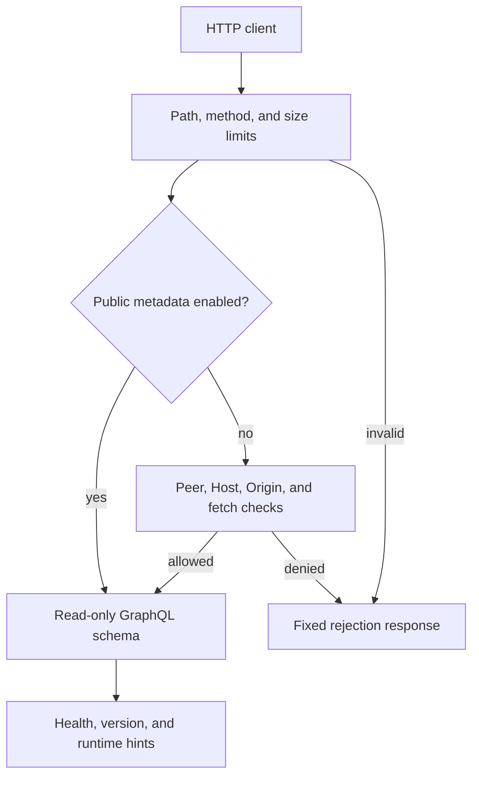

# Architecture

## Overview

The pipeline follows a classic **Extract → Transform → Load** pattern, with each stage in its own module. A thin orchestration layer (`pipeline.py`) wires the three stages and returns aggregated stats.

## Component Map

```
main.py                 ← CLI entrypoint (one-shot or scheduled)
└── pipeline.run_pipeline
    ├── extract.extract_sales    ← reads CSV via pandas
    ├── transform.transform_sales ← converts dicts to Sale ORM objects
    └── load.load                ← dispatches to bulk or upsert strategy
        ├── load_bulk.load_bulk_insert   ← SQLAlchemy bulk_save_objects
        └── load_upsert.load_upsert     ← ON CONFLICT (PG) or row-by-row fallback

Supporting modules:
  config.py       ← env-var parsing (DATABASE_URL, batch size, …)
  database.py     ← engine + session factory + schema bootstrap
  models.py       ← SQLAlchemy ORM: Sale, LogEntry
  load_logging.py ← writes LogEntry records to DB
  load_utils.py   ← shared helpers: chunking, dedup, key checks
  retry.py        ← tenacity exponential-backoff decorator
```

## Data Flow

```
CSV file
  │  pandas.read_csv + column normalisation
  ▼
list[dict]
  │  transform_sales: type coercion, defaults, skip invalid rows
  ▼
list[Sale]           (transient attribute: total_value = qty × price)
  │  load(): bulk_save_objects OR ON CONFLICT DO UPDATE
  ▼
PostgreSQL / SQLite   + LogEntry audit records
```

## Load Strategies

| Strategy | When to use | How it works |
|----------|-------------|--------------|
| `bulk`   | Initial loads, no duplicates | `bulk_save_objects` in batches — fastest |
| `upsert` | Incremental / idempotent runs | PG: `ON CONFLICT DO UPDATE`; others: query then insert/update |

The active strategy is selected at runtime via the `LOAD_MODE` env variable (or the `mode` argument to `load()`).

## Resilience

- **Retry**: `@retry_db` (tenacity) wraps the pipeline run and retries on `OperationalError` with exponential backoff.
- **Batch size**: Both strategies process rows in configurable batches (`LOAD_BATCH_SIZE`) to bound memory use.
- **Audit log**: Every load operation writes a `LogEntry` row (`level`, `message`, `source`, `created_at`).

## Database Schema

```
sales
  id           SERIAL PK
  external_id  VARCHAR(255) UNIQUE NULLABLE   ← upsert key
  product_name VARCHAR(255) NOT NULL
  quantity     INTEGER DEFAULT 1
  unit_price   NUMERIC(12,2) NOT NULL
  sold_at      TIMESTAMPTZ DEFAULT NOW()

logs
  id         SERIAL PK
  level      VARCHAR(16) INDEXED              ← INFO / WARNING / ERROR
  message    TEXT
  source     VARCHAR(128) NULLABLE
  created_at TIMESTAMPTZ DEFAULT NOW()
```

## Migrations

Schema is managed by **Alembic** with autogenerate. See [development.md](development.md#migrations).

## Authentication and credential boundaries

The worker is a local CLI/scheduler. Its caller supplies filesystem access and
database credentials; there is no application login, session store, JWT, refresh
token, or HTTP endpoint that starts an ETL run.

| Component | Credential responsibility |
| --- | --- |
| `main.py`, utility scripts, Alembic startup | Explicitly load the checkout-root `.env`, preserving exported variables |
| `config.load_environment(path)` | Load only the caller-selected dotenv path; imports and getters do not search for files |
| `config.database_url()` | Preserve a full URL, or validate and escape separate PostgreSQL fields with SQLAlchemy 2.1+ |
| `database.engine()` / SQLAlchemy driver | Use the connection string to authenticate to the configured database and apply its transport options |
| `scripts/diagnose_db.py` | Probe that same PostgreSQL destination without echoing credentials or trying a second host |
| Optional GraphQL ASGI app | Serve only health/version and normalized operational hints; no database credentials or ETL access |

At worker startup, configuration produces a connection string for SQLAlchemy.
The engine authenticates through the PostgreSQL driver when it opens a
connection. The worker then reads CSV input, transforms it, and writes sales and
audit records through that connection. A complete URL takes precedence and may
carry TLS, socket, or external authentication options. Separate fields require
an explicit password and are escaped without interpreting password characters
as URL structure. The string necessarily contains the driver's credential
material and must not be logged or serialized.

Compose keeps the database port on host loopback and passes separate fields to
the worker over its configuration. Its bridge network is a trusted local
deployment boundary; it does not provide a new authentication scheme. Password
rotation must update the database account and running clients together. The
environment used to initialize a Postgres volume does not change an account
already stored in that volume.

## GraphQL request flow



Only GET/POST at `/graphql` are supported; GraphiQL and WebSockets are disabled.
The body and query string each have a 64 KiB cap before Strawberry parses them.
These limits do not bound total concurrent work or every possible query cost.

`ETL_GRAPHQL_PUBLIC` absent or `0` selects local access. The actual peer must be
loopback, Host must identify loopback/localhost, and Origin/fetch metadata must
be compatible with local access. Forwarded and X-Forwarded headers are rejected
in this mode. Run Uvicorn on loopback with `--no-proxy-headers`; do not publish
the local mode through a proxy that would itself appear to be a local peer.

`ETL_GRAPHQL_PUBLIC=1` deliberately allows metadata access from any peer. It
does not authenticate callers, and forwarded headers are not used for access
decisions. Other values are invalid. This mode is suitable only when those
fields may be public or an independent gateway controls access. The schema
contains no mutation, database resolver, credential field, or ETL execution.
It does not load a dotenv file; server configuration must already be exported
or explicitly loaded with Uvicorn `--env-file`.
